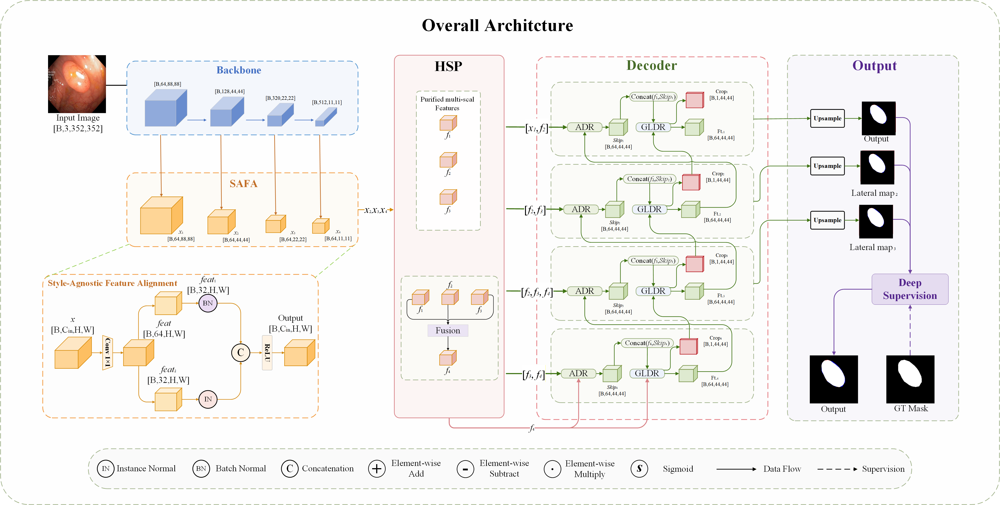

# SCF-Net
# Structurally constrained cross-level feature fusion for polyp segmentation

Official PyTorch implementation of the paper: **Structurally constrained cross-level feature fusion for polyp segmentation**.

---

  

---

